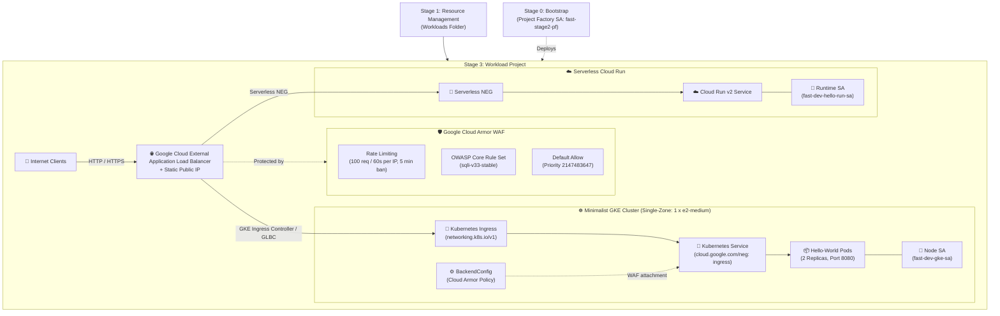

# Google Cloud Foundation Fabric (FAST) - Stage 3 (Workloads) Cloud Run & GKE Kubernetes with Ingress & Load Balancer

This directory provides a production-grade, modular Terraform implementation of **Google FAST Stage 3** (**Workloads** / `3-workloads`), deploying containerized **Hello World applications** on both:
1. **Serverless Cloud Run** protected by **Google Cloud Armor WAF**, **Rate Limiting**, and a **Global External Application Load Balancer** with a **Serverless Network Endpoint Group (NEG)**.
2. **Minimalist Kubernetes (GKE)** cluster with **Container-Native Load Balancing (standalone NEGs)**, **Kubernetes Ingress**, reserved static public IP, and **Cloud Armor WAF** integration via **GKE BackendConfig**.

---

## 1. Role in Google FAST Architecture

**Stage 3 (Workloads)** is where application-level workloads run on top of the foundation created in previous stages:
- Resides inside the `Workloads` folder created in Stage 1 ([`1-resman`](../1-resman)).
- Deployed via the dedicated **Project Factory / Workloads Service Account** (`fast-stage2-pf`) provisioned in Stage 0 ([`0-bootstrap`](../0-bootstrap)).
- Runs under its own isolated Google Cloud project (`fast-dev-app-xxxx`) without administrative access to the landing zone hierarchy, networking host projects, or KMS keyrings.



---

## 2. Kubernetes (GKE) Hello World Architecture & Ingress

### Minimalist Footprint
- **Single-Zone Cluster**: Deploys to a single zone (e.g., `europe-west1-b`) with **1 worker node** (`e2-medium`, 30 GB disk), minimizing compute cost for development and testing.
- **Dedicated Node Service Account**: Follows least-privilege principles (`fast-dev-gke-sa`), granting only `logging.logWriter`, `monitoring.metricWriter`, `monitoring.viewer`, and `artifactregistry.reader`.
- **VPC-Native Networking**: Uses dedicated secondary IP ranges for Kubernetes Pods (`10.100.0.0/16`) and Services (`10.101.0.0/20`), with Private Google Access and Cloud NAT for private egress.

### Container-Native Load Balancing & GKE Ingress
1. **Kubernetes Service Annotation (`cloud.google.com/neg: '{"ingress": true}'`)**:
   - Instructs GKE to create standalone Network Endpoint Groups (NEGs) containing Pod IPs directly, avoiding double-hop kube-proxy routing.
2. **Kubernetes Ingress (`kubernetes.io/ingress.class: "gce"`)**:
   - GKE's built-in Ingress Controller (GLBC) dynamically provisions a Google Cloud External HTTP Application Load Balancer with Forwarding Rules, Target HTTP Proxy, URL Map, and Health Checks.
3. **Static Public IP (`kubernetes.io/ingress.global-static-ip-name`)**:
   - Binds the Ingress to the Terraform-managed static external IPv4 address (`fast-dev-gke-lb-ip`).
4. **BackendConfig WAF Integration**:
   - Attaches the Cloud Armor WAF & Rate Limiting security policy (`fast-dev-armor`) to the Ingress backend service via `BackendConfig`.

---

## 3. Declarative YAML & Dynamic Manifests

### 1. Application Workload Config (`data/hello-world.yaml`)
```yaml
name: hello-world
environment: dev
region: europe-west1

container:
  image: us-docker.pkg.dev/cloudrun/container/hello
  docker_hub_reference: https://hub.docker.com/_/hello-world
  port: 8080
  resources:
    cpu: "1"
    memory: "512Mi"

scaling:
  min_instances: 0
  max_instances: 5

access:
  allow_unauthenticated: true
  ingress: INGRESS_TRAFFIC_INTERNAL_LOAD_BALANCER
```

### 2. Cloud Armor Security Policy (`data/cloud_armor.yaml`)
```yaml
security_policy:
  name: "fast-dev-armor"
  description: "Stage 3 Cloud Armor WAF ja Rate Limiting -tietoturvakäytäntö"
  rules:
    - priority: 500
      action: "rate_based_ban"
      rate_limit_options:
        rate_limit_threshold_count: 100
        rate_limit_threshold_interval_sec: 60
        ban_duration_sec: 300
    - priority: 2000
      action: "deny(403)"
      expression: "evaluatePreconfiguredExpr('sqli-v33-stable')"
    - priority: 2147483647
      action: "allow"
```

### 3. Kubernetes Manifests (`k8s/`)
Terraform automatically generates `k8s/manifests.yaml` with interpolated FAST resource names:
- [`k8s/deployment.yaml`](./k8s/deployment.yaml): 2 replicas, port 8080, liveness/readiness probes.
- [`k8s/service.yaml`](./k8s/service.yaml): ClusterIP with container-native NEG and BackendConfig annotations.
- [`k8s/ingress.yaml`](./k8s/ingress.yaml): GCE Ingress with static global IP.
- [`k8s/backendconfig.yaml`](./k8s/backendconfig.yaml): BackendConfig attaching Cloud Armor security policy.
- [`k8s/kustomization.yaml`](./k8s/kustomization.yaml): Kustomize package for one-command deployment.

---

## 4. Resources Provisioned

1. **Workload Application Project**:
   - Created in the designated Workloads folder (`folder_id`) with billing attached.
   - APIs enabled: `container.googleapis.com`, `run.googleapis.com`, `compute.googleapis.com`, `iam.googleapis.com`, `logging.googleapis.com`, `monitoring.googleapis.com`.
2. **Dedicated Networking (when Shared VPC not passed)**:
   - `google_compute_network.gke_vpc`: Workload VPC (`fast-dev-vpc`).
   - `google_compute_subnetwork.gke_subnet`: Primary node range (`10.10.0.0/24`), secondary ranges `pods` (`10.100.0.0/16`) and `services` (`10.101.0.0/20`).
   - `google_compute_router.gke_router` & `google_compute_router_nat.gke_nat`: Managed NAT gateway.
   - `google_compute_firewall.gke_health_checks`: GLBC and health check firewall rules (`130.211.0.0/22`, `35.191.0.0/16`).
3. **GKE Cluster & Node Pool**:
   - `google_container_cluster.primary`: Single-zone cluster with VPC-native routing, HTTP load balancing, and network policy enabled.
   - `google_container_node_pool.primary_nodes`: 1 x `e2-medium` node with dedicated node service account (`fast-dev-gke-sa`).
   - `google_compute_global_address.gke_ingress_ip`: Dedicated static external IPv4 address.
4. **Cloud Armor Security Policy**:
   - `google_compute_security_policy.cloud_armor`: Rate Limiting and OWASP SQLi inspection.
5. **Cloud Run v2 Service & External Load Balancer**:
   - Serverless NEG, Backend Service, URL Map, HTTP Forwarding Rule.

---

## 5. File Structure

| File | Purpose |
| :--- | :--- |
| [`gke.tf`](./gke.tf) | Minimalist GKE cluster, node pool, node SA, and static Ingress IP |
| [`gke_network.tf`](./gke_network.tf) | Dedicated VPC, subnet with secondary ranges, Cloud Router, NAT, and GLBC health check firewall |
| [`k8s_manifests.tf`](./k8s_manifests.tf) | Dynamically renders `k8s/manifests.yaml` with Terraform FAST parameters |
| [`deploy_k8s.sh`](./deploy_k8s.sh) | Automated script to fetch kubeconfig credentials and deploy manifests via `kubectl` |
| [`k8s/deployment.yaml`](./k8s/deployment.yaml) | Kubernetes Deployment for Hello World (2 replicas, port 8080) |
| [`k8s/service.yaml`](./k8s/service.yaml) | Kubernetes Service with NEG and BackendConfig annotations |
| [`k8s/ingress.yaml`](./k8s/ingress.yaml) | Kubernetes Ingress with GCE class and static IP annotation |
| [`k8s/backendconfig.yaml`](./k8s/backendconfig.yaml) | BackendConfig linking Cloud Armor security policy |
| [`k8s/kustomization.yaml`](./k8s/kustomization.yaml) | Kustomize configuration linking all Kubernetes resources |
| [`cloud_run.tf`](./cloud_run.tf) | Cloud Run v2 service, runtime SA, and invoker IAM policy |
| [`cloud_armor.tf`](./cloud_armor.tf) | Cloud Armor security policy with dynamic rules and rate limiting |
| [`load_balancer.tf`](./load_balancer.tf) | External HTTP(S) LB, Serverless NEG, backend service, and forwarding rules |
| [`locals.tf`](./locals.tf) | Decodes YAML data and enforces FAST naming standards |
| [`versions.tf`](./versions.tf) | Terraform version `>= 1.5.0` and provider constraints (`google`, `random`, `local`) |
| [`variables.tf`](./variables.tf) | Input variables for GKE cluster, node sizing, network CIDRs, folder, and billing |
| [`outputs.tf`](./outputs.tf) | GKE cluster name, credentials command, Ingress IP/URL, Cloud Run endpoint |
| [`terraform.tfvars`](./terraform.tfvars) | Stage 3 deployment variables |
| [`terraform.tfvars.example`](./terraform.tfvars.example) | Example variable configuration |

---

## 6. How to Deploy & Verify

### Step 1: Deploy Infrastructure with Terraform
```bash
cd 3-workloads
terraform init
terraform plan
terraform apply
```

### Step 2: Deploy Kubernetes Hello World Workload
You can deploy using the automated helper script:
```bash
./deploy_k8s.sh
```

Or deploy manually via `kubectl`:
```bash
# 1. Fetch credentials
$(terraform output -raw gke_get_credentials_command)

# 2. Apply manifests
kubectl apply -k k8s/

# 3. Check Ingress status (GCE Ingress Controller takes ~3-5 minutes to program the Google Cloud Load Balancer)
kubectl get ingress -w
```

### Step 3: Verify Internet Connectivity & Load Balancing
Once the Ingress status is programmed:
```bash
GKE_IP=$(terraform output -raw gke_ingress_ip)

# Send request to the Hello World application via the Ingress Load Balancer
curl -i "http://${GKE_IP}/"
# Returns: HTTP/1.1 200 OK
```

### Step 4: Verify Cloud Armor WAF on GKE Ingress
```bash
# Test SQLi attack blocking
curl -i "http://${GKE_IP}/?id=1%20UNION%20SELECT%20username,password%20FROM%20users"
# Returns: HTTP/1.1 403 Forbidden (Blocked by Cloud Armor attached via BackendConfig)
```

