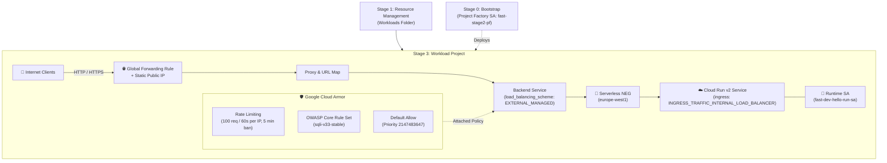

# Google Cloud Foundation Fabric (FAST) - Stage 3 (Workloads) Cloud Run with Cloud Armor & Load Balancer

This directory provides a production-grade, modular Terraform implementation of **Google FAST Stage 3** (**Workloads** / `3-workloads`), deploying a containerized **Hello World application on Cloud Run** protected by **Google Cloud Armor WAF**, **Rate Limiting**, and a **Global External Application Load Balancer** with a **Serverless Network Endpoint Group (NEG)**.

---

## 1. Role in Google FAST Architecture

**Stage 3 (Workloads)** is where application-level workloads run on top of the foundation created in previous stages:
- Resides inside the `Workloads` folder created in Stage 1 ([`1-resman`](../1-resman)).
- Deployed via the dedicated **Project Factory / Workloads Service Account** (`fast-stage2-pf`) provisioned in Stage 0 ([`0-bootstrap`](../0-bootstrap)).
- Runs under its own isolated Google Cloud project (`fast-dev-app-xxxx`) without administrative access to the landing zone hierarchy, networking host projects, or KMS keyrings.



---

## 2. Security Architecture: Cloud Armor WAF & Rate Limiting

1. **Ingress Restriction (`INGRESS_TRAFFIC_INTERNAL_LOAD_BALANCER`)**:
   - The Cloud Run service accepts requests **only** routed through the external Application Load Balancer. Direct access attempts hitting the default `*.a.run.app` URL receive HTTP `403 Forbidden`, preventing attackers from bypassing Cloud Armor inspection.
2. **Rate Limiting (`rate_based_ban`)**:
   - Throttles requests from the same IP address when exceeding **100 requests per 60 seconds**.
   - Banned clients receive HTTP `429 Too Many Requests` for **300 seconds (5 minutes)**.
3. **OWASP Preconfigured WAF Rules**:
   - Evaluates incoming HTTP payloads against Google Cloud Armor preconfigured expression `evaluatePreconfiguredExpr('sqli-v33-stable')` to block SQL injection attacks with HTTP `403 Forbidden`.
4. **Serverless NEG Integration**:
   - GFE (Google Front End) terminates incoming client connections and securely proxies requests through the Serverless NEG to Cloud Run.

---

## 3. Declarative YAML Configuration

Following Google Cloud Foundation Fabric (FAST) best practices, infrastructure logic (Terraform HCL) is decoupled from configuration parameters (YAML) in [`data/`](./data).

### Application Workload Config (`data/hello-world.yaml`)
```yaml
name: hello-world
environment: dev
region: europe-west1

container:
  image: us-docker.pkg.dev/cloudrun/container/hello
  docker_hub_reference: https://hub.docker.com/_/hello-world
  port: 8080
  resources:
    cpu: "1"
    memory: "512Mi"

scaling:
  min_instances: 0
  max_instances: 5

access:
  allow_unauthenticated: true
  ingress: INGRESS_TRAFFIC_INTERNAL_LOAD_BALANCER

env:
  ENVIRONMENT: dev
  APP_NAME: hello-world
```

### Cloud Armor Security Policy Config (`data/cloud_armor.yaml`)
```yaml
security_policy:
  name: "fast-dev-hello-armor"
  description: "Stage 3 Cloud Run Cloud Armor WAF ja Rate Limiting -tietoturvakäytäntö"
  rules:
    # 1. Rate Limiting (max 100 pyyntöä / 60s per IP, ylityksestä 5 min banni)
    - priority: 500
      action: "rate_based_ban"
      preview: false
      description: "Pyyntömäärärajoitus samasta IP-osoitteesta"
      src_ip_ranges:
        - "*"
      rate_limit_options:
        rate_limit_threshold_count: 100
        rate_limit_threshold_interval_sec: 60
        conform_action: "allow"
        exceed_action: "deny(429)"
        enforce_on_key: "IP"
        ban_duration_sec: 300

    # 2. OWASP SQL Injection -suojaus
    - priority: 2000
      action: "deny(403)"
      preview: false
      expression: "evaluatePreconfiguredExpr('sqli-v33-stable')"
      description: "Estetään SQL-injektiohyökkäykset"

    # 3. Oletussääntö
    - priority: 2147483647
      action: "allow"
      preview: false
      src_ip_ranges:
        - "*"
      description: "Sallitaan muu normaali liikenne"
```

Terraform reads and parses both YAML files dynamically via [`locals.tf`](./locals.tf) using `yamldecode()`.

---

## 4. Resources Provisioned

1. **Workload Application Project**:
   - Created in the designated Workloads folder (`folder_id`).
   - Attached to the Organization billing account.
   - Enables core APIs: `run.googleapis.com`, `compute.googleapis.com`, `iam.googleapis.com`, `logging.googleapis.com`, `monitoring.googleapis.com`.
2. **Cloud Armor Security Policy**:
   - `google_compute_security_policy.cloud_armor`: Dynamically generated rules for Rate Limiting, OWASP SQLi inspection, and default allow.
3. **Serverless Network Endpoint Group (NEG)**:
   - `google_compute_region_network_endpoint_group.serverless_neg`: Bridges the Load Balancer to the Cloud Run service.
4. **Backend Service & URL Map**:
   - `google_compute_backend_service.default`: Global backend service with `EXTERNAL_MANAGED` scheme, attached to Cloud Armor.
   - `google_compute_url_map.default`: Routes frontend traffic to the serverless backend service.
5. **Frontend & Load Balancing**:
   - `google_compute_global_address.default`: Dedicated external static IP address.
   - `google_compute_target_http_proxy.default` & `google_compute_global_forwarding_rule.http`: Port 80 HTTP entrypoint.
   - Optional HTTPS (Port 443) with Google-managed SSL certificate enabled when `var.domain` is configured.
6. **Cloud Run v2 Service & Service Account**:
   - `google_cloud_run_v2_service.hello_world`: Deploys container with scaling policies and `INGRESS_TRAFFIC_INTERNAL_LOAD_BALANCER`.
   - `google_service_account.cloud_run_sa`: Dedicated runtime identity.
   - `google_cloud_run_v2_service_iam_member.public_access`: `roles/run.invoker` for unauthenticated requests.

---

## 5. File Structure

| File | Purpose |
| :--- | :--- |
| [`data/hello-world.yaml`](./data/hello-world.yaml) | Declarative application definition (image, ports, CPU, RAM, scaling, env, ingress) |
| [`data/cloud_armor.yaml`](./data/cloud_armor.yaml) | Declarative Cloud Armor WAF and Rate Limiting policy definition |
| [`locals.tf`](./locals.tf) | Decodes YAML data via `yamldecode()` into Terraform configuration |
| [`versions.tf`](./versions.tf) | Terraform version `>= 1.5.0` and Google provider constraints |
| [`variables.tf`](./variables.tf) | Input variables for folder, billing, YAML file paths, and optional domain |
| [`project.tf`](./project.tf) | Workload application project creation and API activation |
| [`cloud_run.tf`](./cloud_run.tf) | Cloud Run v2 service, runtime SA, and invoker IAM policy |
| [`cloud_armor.tf`](./cloud_armor.tf) | Cloud Armor security policy with dynamic rules and rate limiting |
| [`load_balancer.tf`](./load_balancer.tf) | External HTTP(S) LB, Serverless NEG, backend service, and forwarding rules |
| [`outputs.tf`](./outputs.tf) | Public Load Balancer IP/URL, Cloud Armor policy details, Cloud Run URIs |
| [`terraform.tfvars`](./terraform.tfvars) | GitOps landing zone parameters |
| [`terraform.tfvars.example`](./terraform.tfvars.example) | Example variable configuration |

---

## 6. How to Deploy & Verify

### Deployment
```bash
cd 3-workloads
terraform init
terraform plan
terraform apply
```

### Verification & Testing Cloud Armor Rules

1. **Verify Normal Access**:
   ```bash
   LB_IP=$(terraform output -raw load_balancer_ip)
   curl -I "http://${LB_IP}/"
   # Returns: HTTP/1.1 200 OK
   ```

2. **Test OWASP SQLi Protection (Priority 2000)**:
   ```bash
   curl -I "http://${LB_IP}/?id=1%20UNION%20SELECT%20username,password%20FROM%20users"
   # Returns: HTTP/1.1 403 Forbidden (Blocked by Cloud Armor SQLi rule)
   ```

3. **Test Rate Limiting (Priority 500)**:
   ```bash
   # Send 105 rapid requests
   for i in {1..105}; do curl -s -o /dev/null -w "%{http_code}\n" "http://${LB_IP}/"; done
   # First 100 requests return 200, subsequent requests return 429 Too Many Requests
   ```

4. **Verify Direct Ingress Rejection**:
   ```bash
   RUN_URL=$(terraform output -raw service_url)
   curl -I "${RUN_URL}"
   # Returns: HTTP/1.1 403 Forbidden (Cloud Run direct ingress blocked)
   ```
